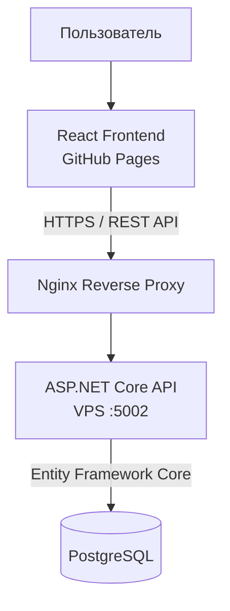

# LabSlot

> Веб-приложение для бронирования лабораторного оборудования, помещений и рабочих мест. Пользователи могут находить ресурсы и управлять бронированиями, администратор — вести каталог ресурсов.

**[Демо](https://vitaliyarmss.github.io/labspot-frontend/)** · **[Frontend](https://github.com/VitaliyArmss/labspot-frontend)** · **[Backend](https://github.com/VitaliyArmss/labspot-backend)** · **[Проверка API](https://api.vitaliy-armss.ru/labspot/health)**

---

## Аккаунты для тестирования

Для тестовой среды, в которой созданы демонстрационные аккаунты:

| Роль | Email | Пароль |
|---|---|---|
| Администратор | `admin@labslot.local` | `Admin123!` |
| Пользователь | `demo@labslot.local` | `Demo123!` |

**Важно:** production-аккаунт администратора создаётся или настраивается на сервере с помощью `LABSLOT_ADMIN_EMAIL` и `LABSLOT_ADMIN_PASSWORD` в `.env`. Поэтому пароль `Admin123!` сработает на публичном демо только в том случае, если именно он настроен для существующей учётной записи. Не публикуй `.env`, JWT-ключи или пароли от реальных аккаунтов в репозитории.

---

## О проекте

LabSlot — учебный full-stack проект для организации бронирования ресурсов в университете, лаборатории или техническом центре. Приложение разделено на независимые frontend и backend, которые взаимодействуют через REST API.

Основные задачи проекта:

- каталог оборудования, помещений и рабочих мест;
- создание, просмотр и отмена бронирований;
- проверка конфликтов временных интервалов на стороне сервера;
- регистрация, аутентификация и разграничение прав доступа;
- управление ресурсами через административный интерфейс;
- хранение данных в PostgreSQL;
- независимый деплой клиентской и серверной частей.

---

## Возможности

### Каталог ресурсов

- просмотр карточек ресурсов и их описаний;
- поиск и фильтрация каталога;
- отображение доступности ресурсов.

### Бронирования

- выбор ресурса, даты и временного интервала;
- просмотр собственных бронирований;
- отмена бронирования;
- проверка пересечения интервалов на backend, чтобы избежать двойного бронирования.

### Пользователи и доступ

- регистрация и вход;
- JWT-аутентификация;
- разделение пользовательских и административных операций;
- проверка прав на стороне API.

### Администрирование

- добавление и редактирование ресурсов;
- управление доступностью ресурсов;
- отдельные операции, доступные администратору.

---

## Технологический стек

### Backend

- C#
- ASP.NET Core Web API
- Entity Framework Core
- JWT
- REST API

### Frontend

- React
- JavaScript
- Vite
- CSS
- Fetch API

### Данные и инфраструктура

- PostgreSQL
- Docker / Docker Compose
- Nginx
- VPS
- GitHub Actions
- GitHub Pages

---

## Репозитории

### Frontend

**[labspot-frontend →](https://github.com/VitaliyArmss/labspot-frontend)**

React-интерфейс: каталог, авторизация, бронирования и административные экраны.

### Backend

**[labspot-backend →](https://github.com/VitaliyArmss/labspot-backend)**

ASP.NET Core API, бизнес-правила, авторизация и работа с PostgreSQL.

### Демо

**[Открыть LabSlot →](https://vitaliyarmss.github.io/labspot-frontend/)**

---

## Архитектура



Frontend публикуется отдельно через GitHub Pages. Backend работает на VPS и доступен по адресу `https://api.vitaliy-armss.ru/labspot`. Nginx перенаправляет этот префикс на приложение, слушающее локальный порт `5002`.

---

## Запуск для разработки

Требуются Node.js, .NET SDK и доступная база PostgreSQL.

### Backend

Перейди в каталог backend, настрой строку подключения к своей базе и необходимые переменные окружения, затем выполни:

```bash
dotnet restore
dotnet run
```

### Frontend

В каталоге frontend установи зависимости:

```bash
npm install
```

Создай `.env.local` и укажи URL локального API, например:

```dotenv
VITE_API_URL=http://localhost:5000
```

Используй фактический адрес и порт, на котором запущен backend. Запусти клиент:

```bash
npm run dev
```

Более подробные требования и команды находятся в README соответствующего репозитория.

---

## Production и безопасность

- Frontend: [GitHub Pages](https://vitaliyarmss.github.io/labspot-frontend/).
- Backend: VPS, Docker-контейнер и Nginx reverse proxy.
- API: `https://api.vitaliy-armss.ru/labspot`.
- Секреты и параметры подключения к базе хранятся на сервере, а не в GitHub.
- SQL-файл начальной инициализации не является резервной копией пользовательских данных.

---

## Дальнейшее развитие

Возможные направления развития проекта:

- автоматизированные тесты;
- улучшение логирования и мониторинга;
- уведомления о бронированиях;
- расширение правил доступности ресурсов;
- улучшение календарного интерфейса;
- дальнейшая автоматизация CI/CD.
